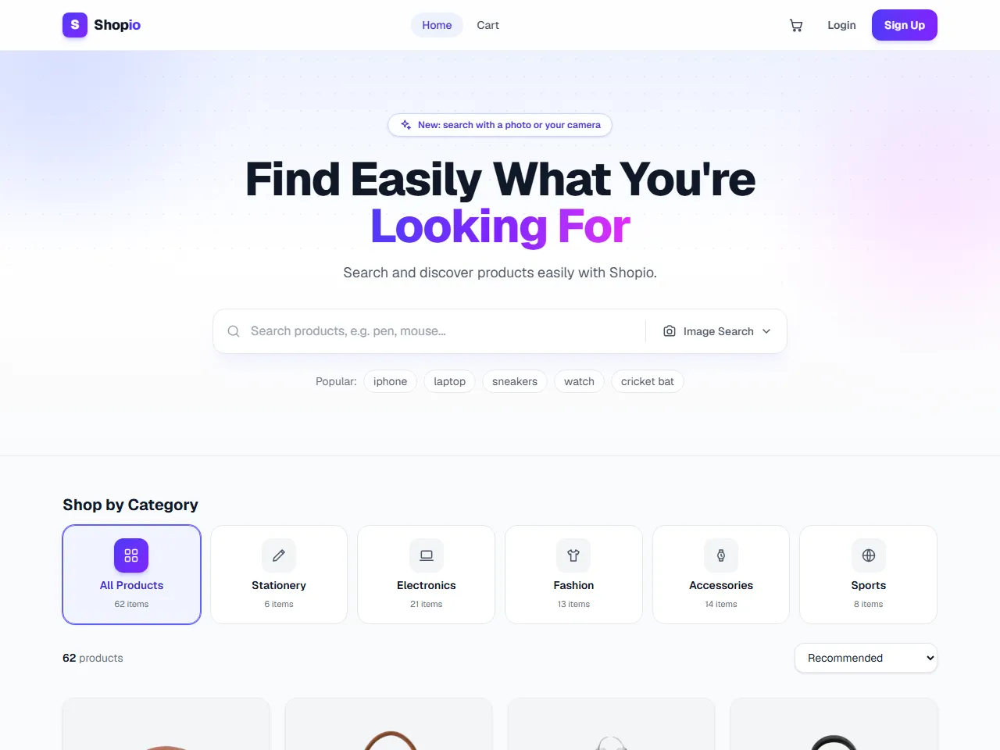
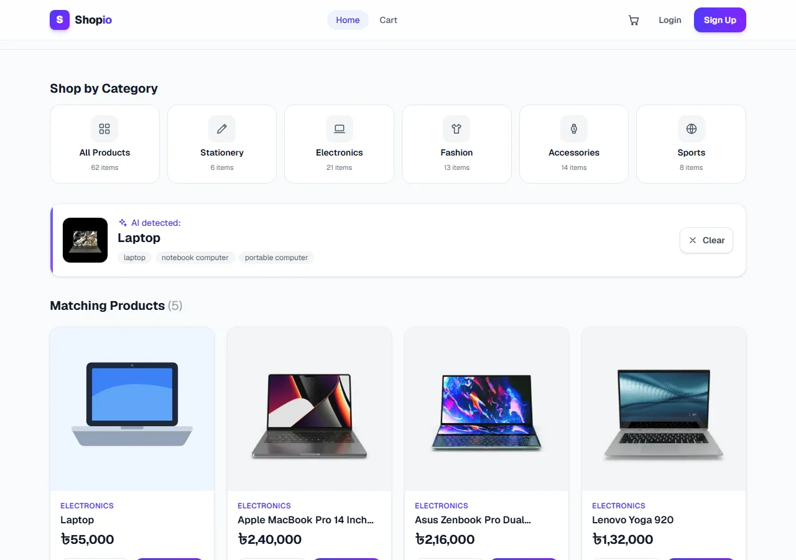
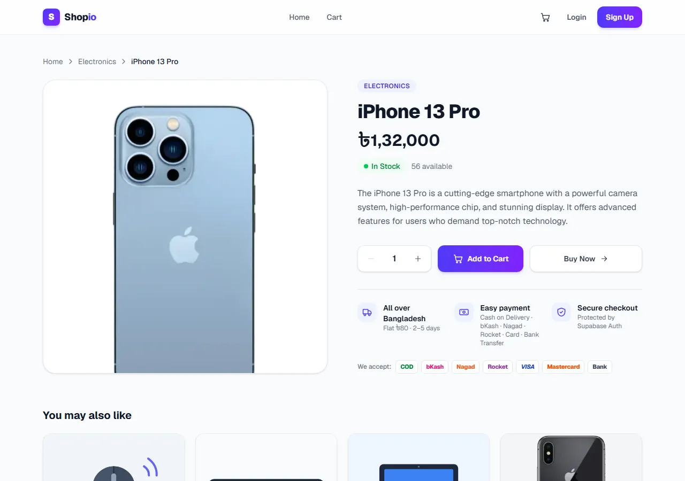
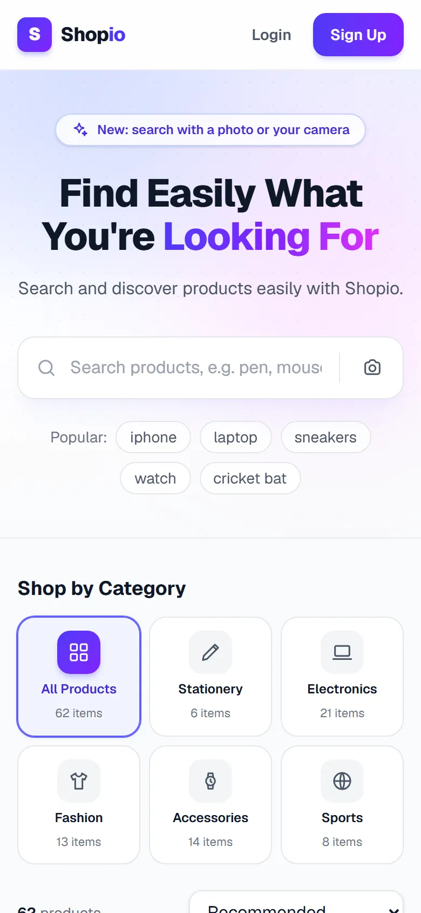
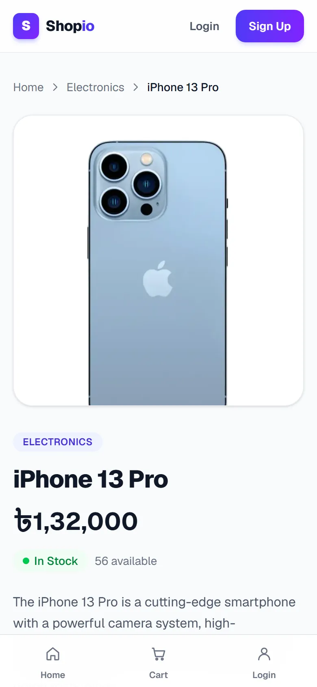
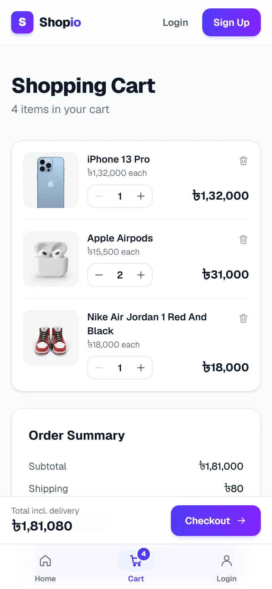
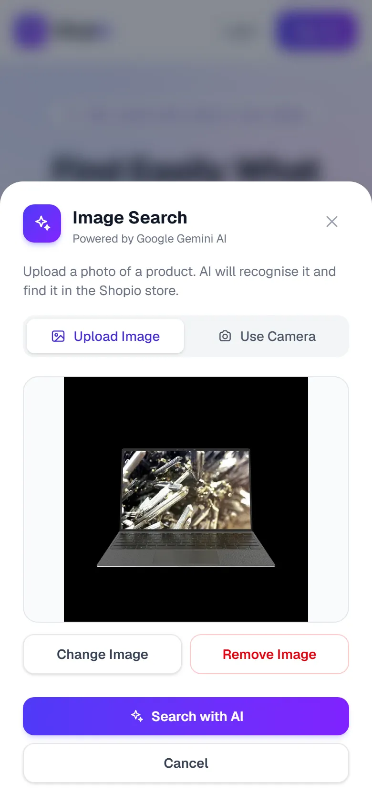

<h1 align="center">Shopio</h1>

<p align="center">
  <strong>AI-Powered Single-Vendor E-commerce Web Application</strong><br>
  Search by text, photo or camera · Bangladesh-ready checkout · Full admin portal
</p>

<p align="center">
  <a href="https://shopio-ai-commerce.vercel.app"><b>Live Demo</b></a> ·
  <a href="docs/CASE_STUDY.md"><b>Case Study</b></a> ·
  <a href="SUPABASE_SETUP.md"><b>Supabase Setup</b></a>
</p>

<p align="center">
  
  
  
  
  
  
</p>

<p align="center">
  
</p>

---

## Contents

- [Overview](#overview)
- [Features](#features)
- [Screenshots](#screenshots)
- [Tech stack](#tech-stack)
- [How visual search works](#how-visual-search-works)
- [Getting started](#getting-started)
- [Configuration](#configuration)
- [Admin access](#admin-access)
- [Payments (Bangladesh, demo)](#payments-bangladesh-demo)
- [Security](#security)
- [Deployment](#deployment)
- [Project structure](#project-structure)
- [Troubleshooting](#troubleshooting)
- [Limitations](#limitations)
- [Documentation](#documentation)
- [Acknowledgements](#acknowledgements)

---

## Overview

Shopio is a university ecommerce web application where users can browse, search and purchase
products from a single vendor.

The application includes traditional text search and AI-powered visual product search. Shoppers
can upload a photo or take one with their camera. Google Gemini identifies the product, and
Shopio shows the matching items from its own catalog, or related items if the exact product is
not sold.

The store is built for **Bangladesh**:

- Prices in ৳ with lakh grouping
- Cash on Delivery, bKash, Nagad and Rocket payments
- Bangladeshi mobile-number checks and divisions in the address

> 📘 Read the **[case study](docs/CASE_STUDY.md)** for the architecture, design decisions,
> security model, test results and measured performance and mobile improvements.

## Features

### For customers

- **Account:** registration and login with Supabase Auth (email + password).
- **Browsing:** product browsing with **Shop by Category** tiles, sorting and "Show more" pagination.
- **Text search:** instant, case-insensitive matching on the start of words (`mou` finds
  "Wireless Mouse"); exact matches are ranked first.
- **AI image search:** upload a photo **or** take one with the camera.
- **Related products:** suggested when the exact product is not sold.
- **Product details:** quantity selector, Buy Now and "You may also like".
- **Shopping cart:** saved in the browser, with a live badge and an "Added to cart" toast.
- **Checkout for Bangladesh** with 3 payment options:
  1. Cash on Delivery
  2. Mobile banking: bKash, Nagad, Rocket (demo)
  3. Card or bank transfer (demo)
- **My Orders:** a Placed → Processing → Completed tracker.

### For admins

- **Dashboard:** total products, total orders, pending orders, customers and recent orders.
- **Products:** add, edit and delete with image upload to Supabase Storage; category filter.
- **Orders:** status filters with counts, status updates, orders per customer.
- **Payments:** turn methods on/off, set merchant numbers and the bank account, verify payments.
- **Users:** search, order count, total spent, and **role management** (customer / admin).

### Platform

- **Mobile-first:** bottom tab bar, 2-column product grid, account menu, sticky checkout bar.
- **Fast:** streaming pages, local JWT verification, database indexes, optimised images.
- **Polished:** loading skeletons, animations that respect reduced-motion settings, accessible labels.

## Screenshots

<p align="center">
  
  <br><em>AI image search: a laptop photo is recognised and matching products from the catalog are shown.</em>
</p>

<p align="center">
  
  <br><em>Product page with quantity selector, Buy Now, stock status and accepted payment methods.</em>
</p>

<p align="center">
  
  
  
  
  <br><em>Mobile: home, product, cart with sticky checkout bar, and image search.</em>
</p>

## Tech stack

| Layer | Technology |
| --- | --- |
| Frontend | React 19, Next.js 16 (App Router, Server Components, Server Actions), Tailwind CSS 4 |
| Database | Supabase PostgreSQL with Row Level Security |
| Authentication | Supabase Auth (email + password, `@supabase/ssr`) |
| File storage | Supabase Storage (`product-images` bucket) |
| AI | Google Gemini API (`@google/genai`, `gemini-3.5-flash-lite` with automatic fallback) |
| Hosting | Vercel |

No Redux, no Prisma and no separate backend. Next.js Server Components and Server Actions talk to
Supabase directly.

## How visual search works

```
Image
 ↓
Next.js API  (/api/image-search)
 ↓
Gemini
 ↓
Object / Search Terms
 ↓
Supabase Products
 ↓
Exact Match
 OR
Related Products
```

1. The customer clicks **Image Search** next to the search box and chooses **Upload Image** or
   **Take Photo**. The photo is resized in the browser so large phone photos upload quickly.
2. The browser sends it to the Route Handler `/api/image-search`. The Gemini API key stays on the
   server.
3. Gemini returns structured JSON: the main `object` (e.g. `pen`), a `category`, `searchTerms`
   and `relatedTerms`.
4. The server searches the **real** Supabase `products` table (name, category, keywords) and
   shows **Matching Products**, or **Related Products** if nothing matches exactly.

**Gemini never invents products.** Everything shown exists in the database. Normal text search
does **not** use AI.

## Getting started

### Prerequisites

- [Node.js](https://nodejs.org) 20.9 or newer, and npm
- A free [Supabase](https://supabase.com) project
- A [Gemini API key](https://aistudio.google.com/apikey). Optional: without it, everything works
  except image search.

### 1. Install

```bash
git clone https://github.com/shariardipto/Shopio-Ai-Commerce.git
cd Shopio-Ai-Commerce
npm install
```

### 2. Configure

Copy `.env.example` to `.env.local` and fill in your values:

```
NEXT_PUBLIC_SUPABASE_URL=
NEXT_PUBLIC_SUPABASE_PUBLISHABLE_KEY=
GEMINI_API_KEY=
```

### 3. Set up the database

In the Supabase **SQL Editor**, run:

1. `supabase/schema.sql` (tables, security policies, functions, storage bucket)
2. `supabase/seed.sql` (62 demo products)

Both scripts are safe to run again. The full guide is in [SUPABASE_SETUP.md](SUPABASE_SETUP.md).

### 4. Run

```bash
npm run dev
```

Open http://localhost:3000.

| Script | What it does |
| --- | --- |
| `npm run dev` | Start the development server |
| `npm run build` | Create a production build |
| `npm start` | Run the production build |
| `npm run lint` | Check the code with ESLint |

## Configuration

| Variable | Required | Visible to browser | Purpose |
| --- | --- | --- | --- |
| `NEXT_PUBLIC_SUPABASE_URL` | Yes | Yes | Supabase project URL |
| `NEXT_PUBLIC_SUPABASE_PUBLISHABLE_KEY` | Yes | Yes | Public Supabase key (all access is controlled by RLS) |
| `GEMINI_API_KEY` | For image search | **No** (server only) | Google Gemini API key |
| `GEMINI_MODEL` | No | No | Force a specific Gemini model |

**Gemini model:** the project brief named `gemini-2.5-flash-lite`, but Google now replies *"This
model is no longer available to new users"*.

- Shopio uses the current `gemini-3.5-flash-lite` and falls back to other models automatically.
- If a model is retired again, it asks Google which models the key can use and picks the newest
  Flash-Lite.
- Open `/api/image-search` in the browser to check the setup. `"configured": true` means the key
  is set; the key itself is never shown.

## Admin access

1. Sign up in the app. Every new account is a `customer`.
2. In the Supabase **SQL Editor**, promote that account:

   ```sql
   update public.profiles
   set role = 'admin'
   where email = 'ADMIN_EMAIL';
   ```

3. Refresh the page. **Admin** appears in the navigation.

Only the first admin needs SQL. After that, admins manage roles on **Admin → Users**. Nobody can
make themselves admin from the website:

- The signup trigger always creates a `customer`.
- Customers may only edit their own name.
- Admins cannot change their own role, so the store always keeps at least one admin.

## Payments (Bangladesh, demo)

| Option | How it works | Saved with the order | Payment status |
| --- | --- | --- | --- |
| Cash on Delivery | Pay the delivery person | — | `pending` |
| bKash / Nagad / Rocket | "Send Money" to the merchant number, then enter wallet number + TrxID | Last 4 digits of the wallet number, TrxID | `paid_demo` |
| Card | Visa / Mastercard / Amex form with live card preview and number check | Last 4 digits only | `paid_demo` |
| Bank transfer | Transfer to the shop's bank account, then enter the reference number | Reference number | `paid_demo` |

- **No real financial transaction occurs.** No payment gateway is connected.
- **Raw card information is never stored.** Card number, expiry, CVV, PIN and OTP never leave the
  browser.
- **Admin control:** admins turn methods on or off and set merchant numbers on **Admin → Payments**.
- **Test details:**
  - Card: `4242 4242 4242 4242`, any future expiry, any 3-digit CVV.
  - Mobile banking: any BD number such as `01712345678` and any TrxID such as `9BC4D7E2F1`.

## Security

| Area | Protection |
| --- | --- |
| Data access | Row Level Security on every table: customers see only their own orders and profile |
| Prices | `place_order()` reads real prices in the database; orders cannot be inserted directly |
| Admin | Checked in the proxy, in every admin page and every Server Action, with RLS as the final gate |
| Roles | Signup always creates `customer`; roles change only through the admin-only `set_user_role()` |
| Secrets | `GEMINI_API_KEY` is server-only; no Supabase service-role key is used; `.env.local` is git-ignored |
| Payments | Only the last 4 digits and TrxID / reference are stored |

The database rules are covered by 30 tests run against a local Postgres. See the
[case study](docs/CASE_STUDY.md#6-deep-dive-security).

## Deployment

1. Push the repository to GitHub.
2. In [Vercel](https://vercel.com): **Add New → Project**, then import the repository (framework:
   Next.js).
3. Add the environment variables from [Configuration](#configuration).
4. Deploy.
5. In Supabase, open **Authentication → URL Configuration**:
   - Set **Site URL** to your Vercel URL.
   - Add `https://YOUR-APP.vercel.app/**` to **Redirect URLs** (needed for email confirmation
     links).

Every push to `main` redeploys automatically.

## Project structure

```
src/
  app/                     Pages (App Router)
    api/image-search/      AI image search API (Gemini + catalog matching)
    admin/                 Admin pages + admin Server Actions
    checkout/              Checkout page + placeOrder Server Action
    auth/callback/         Email confirmation link handler
  components/              UI components (Navbar, ProductCard, PaymentSection, ...)
  lib/                     Helpers (auth, cart, search, settings, formatting, images)
  utils/supabase/          Supabase browser + server clients
  proxy.js                 Session refresh and login guard
supabase/
  schema.sql               Tables, RLS policies, functions, indexes, storage bucket
  seed.sql                 62 demo products
public/images/products/    Product photos
docs/                      Case study and screenshots
```

## Troubleshooting

| Problem | Solution |
| --- | --- |
| "Could not load products" | Check the two Supabase variables and that `schema.sql` / `seed.sql` have been run |
| "AI image search is not configured" | Set `GEMINI_API_KEY` (and redeploy on Vercel) |
| "Please check the Gemini API key" | The key is wrong or disabled. Create a new one in Google AI Studio |
| Checkout fails / admin pages show errors | Run the latest `supabase/schema.sql` again |
| Live camera does not start | The live camera needs HTTPS or localhost. Otherwise Shopio opens the phone's camera app instead |
| Build fails with "Cannot find module '@tailwindcss/postcss'" | Your shell has `NODE_ENV=production`; run `npm install --include=dev` |

## Limitations

- Single vendor only.
- Demo payments only: bKash, Nagad, Rocket, card and bank transfer are simulated.
- Bangladesh only (BD mobile numbers and divisions).
- Basic stock management: the admin edits stock and out-of-stock products cannot be ordered, but
  stock is not reduced automatically.
- AI recognition depends on the model output and photo quality.
- University / demo project: no rate limiting on the image search API and no email notifications.

## Documentation

| Document | Contents |
| --- | --- |
| [docs/CASE_STUDY.md](docs/CASE_STUDY.md) | Problem, architecture, AI search design, security model, performance, mobile UX, lessons learned |
| [SUPABASE_SETUP.md](SUPABASE_SETUP.md) | Step-by-step database, auth, admin and payment setup |

## Acknowledgements

- Product data and photos for 50 items: [DummyJSON](https://dummyjson.com), a free demo dataset.
  Prices are converted to BDT.
- [Google Gemini](https://ai.google.dev), [Supabase](https://supabase.com),
  [Next.js](https://nextjs.org), [Tailwind CSS](https://tailwindcss.com) and
  [Vercel](https://vercel.com).
