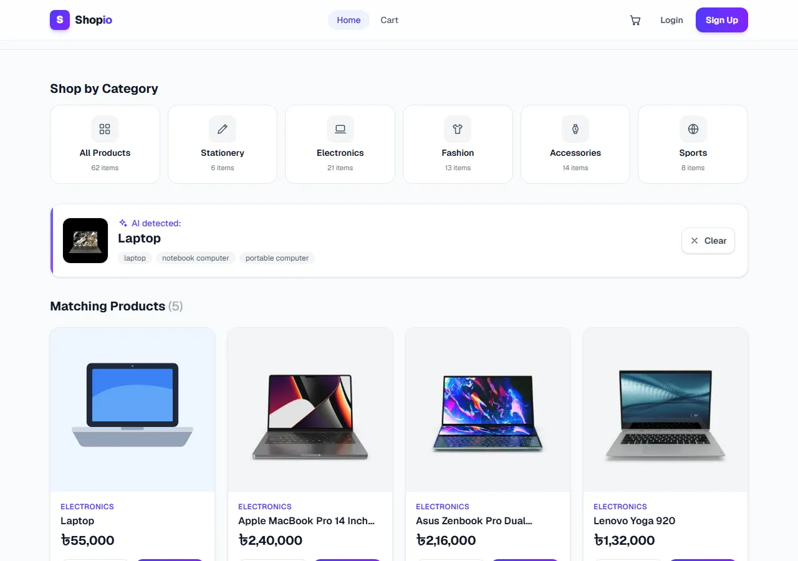
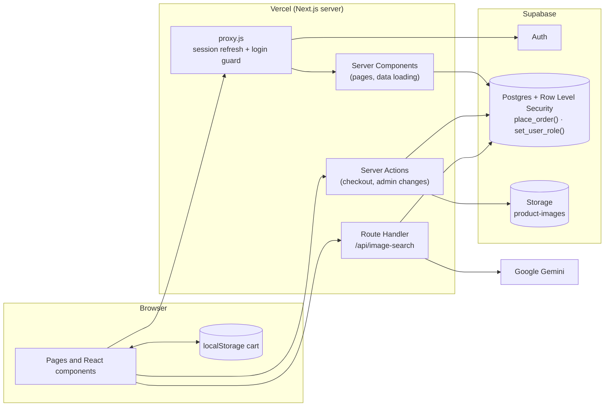
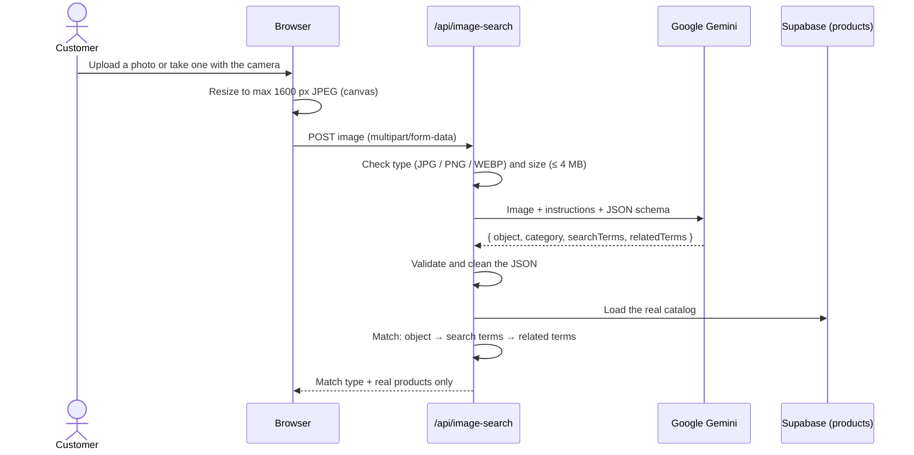
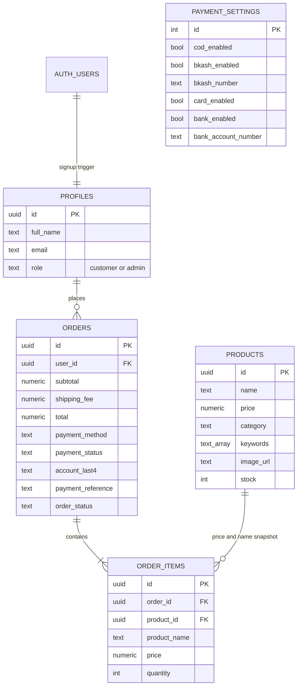
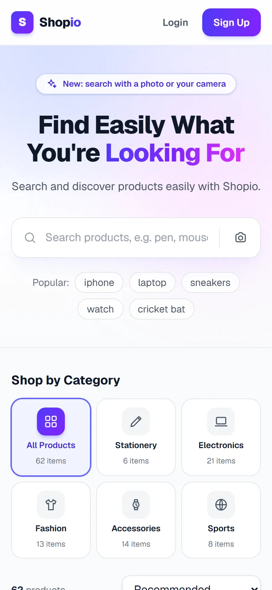
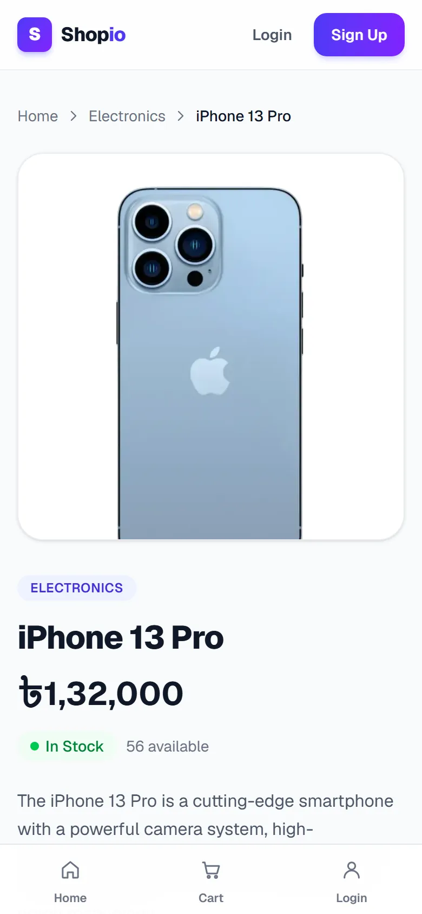
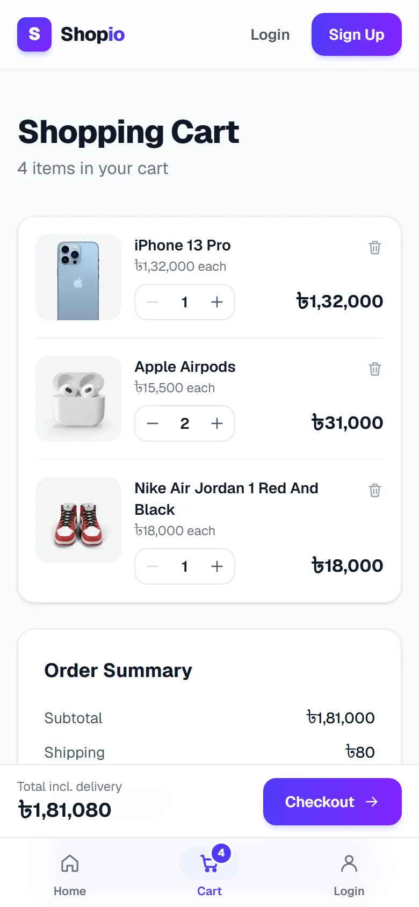
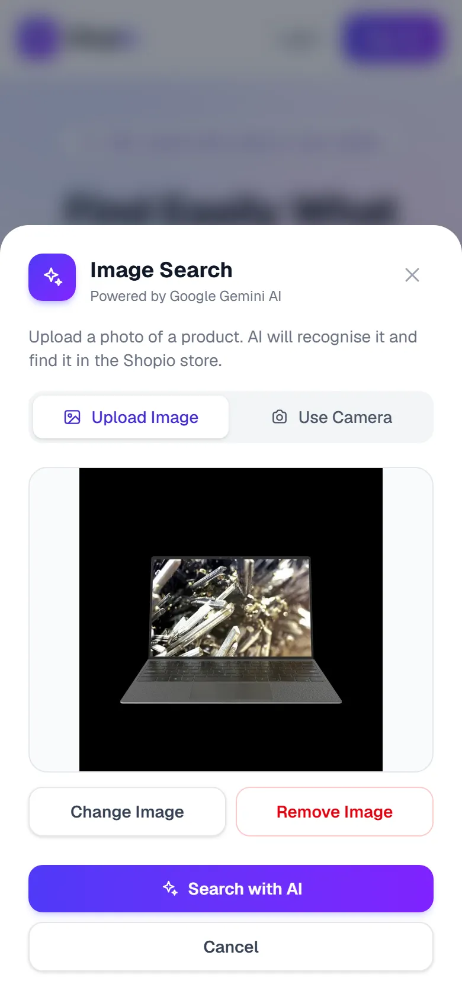

# Shopio — Case Study

### An AI-powered, single-vendor e-commerce store built for Bangladesh

[Live demo](https://shopio-ai-commerce.vercel.app) · [Source code](https://github.com/shariardipto/Shopio-Ai-Commerce) · [README](../README.md) · [Supabase setup](../SUPABASE_SETUP.md)

  

---

## At a glance

| | |
| --- | --- |
| **Type** | University project: full-stack web application |
| **Problem** | Shoppers cannot always name what they want, and Bangladeshi shoppers expect Cash on Delivery and mobile banking |
| **Solution** | A single-vendor store with text search, AI photo and camera search, a Bangladesh-ready checkout and a full admin portal |
| **Stack** | Next.js 16 (App Router), React 19, Tailwind CSS 4, Supabase (Postgres, Auth, Storage), Google Gemini, Vercel |
| **Size** | 17 routes · 5 database tables · 62 products · 65 source files (~6,500 lines) |
| **Status** | Deployed on Vercel |

---

## 1. Context and problem

**Text search only works if you know the product's name.** A customer holding a pen, a cricket
bat or a pair of sneakers can take a photo faster than they can guess the right keyword.

**Checkout has to match local habits.** In Bangladesh, Cash on Delivery and mobile banking
(bKash, Nagad, Rocket) are the everyday ways to pay, phone numbers follow the `01XXXXXXXXX`
format, addresses are organised by division, and prices are written with lakh grouping
(৳1,20,000).

**The project had academic constraints:**

- It must be small and clear enough to explain in a viva.
- Plain JavaScript (no TypeScript) and as few libraries as possible: no Redux, no Prisma,
  no separate backend server.
- It was built in three planned steps:
  - **A:** storefront, auth and cart
  - **B:** admin, checkout and orders
  - **C:** AI search, polish and deployment

## 2. Goals

1. **Complete shopping flow:** browse, search, product details, cart, checkout and order tracking.
2. **Visual search that never invents products.** The AI only describes the photo; every result
   must be a real product from the store's database.
3. **Secure by design.** Customers must not be able to change prices, read other people's
   orders or make themselves admin, even by calling the API directly.
4. **A Bangladesh-ready checkout** with demo payments for COD, mobile banking, card and bank transfer.
5. **A fast, responsive, mobile-first interface.**

## 3. Users and key flows

| Customer | Admin |
| --- | --- |
| Browse 62 products in 5 categories without an account | Dashboard: products, orders, pending orders, customers, recent orders |
| Text search, category tiles, sorting | Add, edit and delete products with image upload |
| **Image Search**: upload a photo **or** take one with the camera | Orders: filter by status, update status, view by customer |
| Cart stored in the browser (no login needed) | Payments: turn methods on/off, set merchant numbers, verify TrxIDs |
| Checkout (login required) with 3 payment options | Users: search, order count, total spent, change roles |
| My Orders with a Placed → Processing → Completed tracker | |

---

## 4. Architecture

| Decision | Why |
| --- | --- |
| **Next.js App Router with Server Components** | Data is loaded on the server, close to the database, with no separate backend to build or explain |
| **Server Actions for every change** | Checkout and admin changes run on the server and re-check the user's permissions every time |
| **Row Level Security as the final gate** | Even if a page or action forgot a check, the database itself refuses the request |
| **Order creation inside a database function** | `place_order()` reads real prices and saves the order and its items in one transaction |
| **Cart in `localStorage`** | Visitors can shop without an account, and abandoned carts never touch the database |
| **Gemini called only from the server** | The API key never reaches the browser |

---

## 5. Deep dive: AI visual search

### How it works

**The AI identifies the object; the database decides what to show.** Gemini returns structured
JSON (enforced with a response schema), and the server validates and cleans every field before
using it. Gemini never chooses or invents products.

### Matching rules

1. **Exact (object):** products whose name or keywords contain the detected object as whole
   words. So `pen` matches "Blue Ballpoint Pen" but not "HB Pencil".
2. **Exact (search terms):** if nothing matched, try Gemini's other search terms, ignoring broad
   category words (otherwise "stationery" would match every stationery item).
3. **Related:** if there is still no exact match, use Gemini's related terms, for example
   *pen → pencil, notebook, eraser*. Up to 8 products.
4. **None:** a clear message that nothing matching or related is in stock.

Normal **text search does not use AI**. It filters the products already loaded in the browser,
matches the start of words (so `mou` finds "Wireless Mouse") and ranks exact word matches first
(so `pen` lists the pens before "HB Pencil").

### Measured results (real Gemini calls on the live 62-product catalog)

| Photo | Gemini detected | Shopio showed | Time |
| --- | --- | --- | --- |
| Laptop | `laptop` | **Matching:** Laptop, MacBook Pro 14, Asus Zenbook, Lenovo Yoga 920, Dell XPS 13 | 3.6 s |
| Pen | `pen` | **Matching:** Blue Ballpoint Pen, Black Gel Pen | 2.9 s |
| Perfume | `perfume bottle` | **None:** "No matching or related products are currently available." | 2.8 s |

Matching checks on the same catalog (with simulated Gemini answers):

- smartphone → all 8 phones
- headphones → AirPods and Beats Flex
- cricket bat → only the Cricket Bat
- handbag → the 3 handbags

### Camera search

- **Live camera:** `getUserMedia` shows a live preview with a viewfinder and a shutter button,
  plus a front/back camera switch.
- **Fallback:** if the live camera is unavailable (no HTTPS, permission denied, no camera), the
  phone's own camera app opens instead (`<input capture>`).
- **Smaller uploads:** photos are resized in the browser first, so 5–10 MB phone photos stay well
  under the 4 MB upload limit and upload quickly.

### Incident: the AI model was retired

**Symptom:** after deployment, camera search on a phone showed *"Unable to analyze the image
right now."*

**Investigation:**

1. The server log showed Gemini returning **404** for every model.
2. Listing the models available to the API key, and testing them one by one, revealed
   Google's own explanation: *"This model models/gemini-2.5-flash-lite is no longer available
   to new users."* That was the model named in the project brief.

**Fix:**

- Use the current `gemini-3.5-flash-lite` first, and fall back to other models if one is unavailable.
- If every model fails, the server asks Google which models the key can use, picks the newest
  Flash-Lite, and remembers it.
- Specific messages for a wrong key, an exhausted quota and other failures.
- `GET /api/image-search` health check that shows whether the AI is configured (never the key itself).

**Lesson:** an external AI model is a dependency with a lifecycle. Design for it to change.

---

## 6. Deep dive: security

### Threat model

| Threat | Defence |
| --- | --- |
| A customer edits prices in the browser | The browser sends only product IDs and quantities. `place_order()` reads real prices from the database, and there is **no** INSERT policy on `orders`, so orders cannot be written directly |
| A customer makes themselves admin through the API | The signup trigger always creates a `customer`, and customers may update **only** their own `full_name` (column-level privilege) |
| A customer reads someone else's orders | RLS: `user_id = auth.uid()`, admins excepted |
| A non-admin calls admin actions | Four layers: proxy (login), page check, Server Action check, RLS |
| The last admin locks everyone out | `set_user_role()` refuses to change the caller's own role |
| Secrets leak to the browser | The Gemini key is server-only, no Supabase service-role key exists anywhere, and `.env.local` is git-ignored |
| Card data is exposed | Card number, expiry and CVV never leave the browser; only the last 4 digits and TrxID / reference are stored |
| A disabled payment method is used | `place_order()` checks the admin's payment settings |

**Found during review:** an early version allowed any customer to update their whole profile row,
which included `role`. One API call could have made them an admin. Column-level privileges
closed the hole.

### Verification: testing SQL like code

Supabase's SQL editor gives little feedback, so the database was tested with a throwaway
**Postgres 17 in Docker**, using stand-ins for Supabase's `auth` and `storage` schemas.

- **Replays the real upgrade path:** original schema → seed → users → new schema twice
  (proving it is safe to run again).
- **Runs 30 security and business-rule tests.** All 30 pass, for example:
  - customers cannot self-promote, insert orders or read others' orders
  - totals are calculated by the database
  - non-Bangladeshi phone numbers are rejected
  - disabled methods and out-of-stock products are refused
- **It caught a real bug.** A `CASE … WHEN … THEN` inside a PL/pgSQL `IF` condition was cut off
  at its first `THEN`, causing a syntax error. In Supabase that error had silently rolled back the
  entire migration, which explained why the live database had not updated.

### Data model

---

## 7. Built for Bangladesh

| Payment option | Customer experience | Stored with the order |
| --- | --- | --- |
| **Cash on Delivery** | Pay the delivery person | — |
| **bKash / Nagad / Rocket** | Step-by-step guide (USSD code `*247#` / `*167#` / `*322#`, Send Money to the merchant number), then wallet number + TrxID | Last 4 digits of wallet number, TrxID |
| **Card** | Live card preview, Visa / Mastercard / Amex detection, card-number checksum (Luhn) check | Last 4 digits |
| **Bank transfer** | Shop's bank account details, then reference number | Reference number |

All online payments are **demo only**. No gateway is connected.

- **Admin control:** admins switch methods on or off and set merchant numbers and the bank account
  on **Admin → Payments**. The checkout, the "We accept" badges and the database all follow
  those settings.
- **Payment verification:** admins can mark payments Paid or Failed after checking a TrxID.
- **Localisation:**
  - Mobile numbers are normalised (`+8801…` → `01…`) and validated in the browser, the server
    and the database.
  - Addresses include the 8 divisions.
  - Prices use lakh grouping, and dates use Dhaka time.

## 8. Performance

| Technique | Effect |
| --- | --- |
| `supabase.auth.getClaims()` with the project's ES256 signing key | Logins are verified locally, removing Supabase Auth round-trips from every page load (proxy and layout) |
| Streaming with React `use()` + `Suspense` | The hero and search bar render immediately while products stream in behind skeletons; related products stream separately |
| Parallel queries (`Promise.all`) and React `cache()` | The layout, footer and page share one user lookup and one settings query per request |
| Database indexes and `(select auth.uid())` in RLS | Faster foreign-key lookups; Postgres evaluates the user check once per query instead of once per row |
| Image pipeline | 50 product photos converted to 800 px WebP (2.9 MB → 1.8 MB), responsive `sizes`, eager loading only above the fold, customer photos resized before upload |
| "Show more" pagination | 16 products at first instead of all 62 |

## 9. Mobile-first UX

Layouts were measured with Chrome DevTools Protocol emulating a **390 px iPhone** (and 320 px for
the narrowest phones), including an automatic check for anything wider than the screen.

| Measurement | Before | After |
| --- | --- | --- |
| Home page length | 10,521 px | 4,751 px (**−55%**) |
| Product page length | 4,568 px | 2,935 px (**−36%**) |
| Cart overflow (content wider than the screen) | 39 px | **0 px** |
| Categories visible without scrolling | 3 of 6 | **6 of 6** |

What changed:

- **Layout:** a 2-column product grid, a bottom tab bar (Home · Cart · Orders · Admin) and category
  tiles.
- **Shopping flow:** a sticky "Total · Checkout" bar on the cart, quantity next to Add to Cart, and
  an account menu.
- **Phone details:**
  - 16 px form fields, so iOS does not zoom in when a field is tapped.
  - Safe-area padding for the iPhone home bar.
  - A bottom-sheet image search.

  
  
  
  

## 10. Data

`supabase/seed.sql` loads **62 products** in 5 categories:

| Category | Products |
| --- | --- |
| Stationery | 6 |
| Electronics | 21 |
| Fashion | 13 |
| Accessories | 14 |
| Sports | 8 |

- **Sources:** 12 hand-made demo items, plus 50 real products (iPhone, Samsung, MacBook, Nike,
  Longines, cricket gear and more) from the free [DummyJSON](https://dummyjson.com) dataset.
- **Prices:** converted at 1 USD ≈ ৳120.
- **Keywords:** chosen for both text search and AI matching.
- **Photos:** stored in the repository, so the store does not depend on another website.
- **Safe to re-run:** running the seed again never creates duplicates.

## 11. Quality and testing

| Check | How | Result |
| --- | --- | --- |
| Lint | ESLint with the Next.js and React Hooks rules | 0 errors |
| Production build | `next build` | Passes (17 routes) |
| Database security | Docker Postgres harness, upgrade path + 30 tests | 30 / 30 pass |
| Search logic | Scripted checks on the 62-product catalog | Expected matches (see §5) |
| AI route | Missing image, wrong type, > 4 MB, wrong key, real photos | Correct status codes and messages |
| Mobile layout | CDP emulation at 390 px and 320 px with overflow detection | No horizontal overflow |

The repository has no automated test suite yet. Adding one is listed under future work.

## 12. Challenges and lessons

1. **AI models are dependencies with a lifecycle.** Fallbacks, automatic model discovery and a
   health endpoint turned a hard failure into a self-healing feature.
2. **Security belongs in the database.** RLS and a single `place_order()` function protect the
   store, however the API is called.
3. **SQL deserves real tests.** A throwaway database showed the policies work and caught a syntax
   error that Supabase had silently rolled back.
4. **Measure the UI on real device sizes.** Emulated phones gave hard numbers (page length,
   overflow, visible categories) that guided the mobile redesign.
5. **Never trust the AI's output.** The response schema, validation and clean-up keep a bad
   model response from breaking the page.

## 13. Limitations and future work

- **Payments:** a real gateway (e.g. SSLCommerz or the bKash Checkout API) with payment webhooks.
- **Stock:** deduct stock on orders and restock cancelled ones (currently managed manually by the admin).
- **AI endpoint:** rate limiting and abuse protection on `/api/image-search`.
- **Notifications:** order confirmations by email and SMS.
- **Delivery:** charges by zone, e.g. inside / outside Dhaka (currently a flat ৳80).
- **Language:** Bangla interface.
- **Testing:** automated Playwright end-to-end tests and unit tests in CI.
- **Catalog:** real product photography and licensed product data.

---

## Appendix

### A. Routes

| Area | Routes |
| --- | --- |
| Customer | `/` · `/product/[id]` · `/cart` · `/checkout` · `/order-success` · `/my-orders` · `/login` · `/signup` |
| Admin | `/admin` · `/admin/products` · `/admin/products/new` · `/admin/products/[id]/edit` · `/admin/orders` · `/admin/payments` · `/admin/users` |
| API and auth | `/api/image-search` · `/auth/callback` |

### B. Environment variables

| Name | Where it is used |
| --- | --- |
| `NEXT_PUBLIC_SUPABASE_URL` | Browser and server |
| `NEXT_PUBLIC_SUPABASE_PUBLISHABLE_KEY` | Browser and server (public key, protected by RLS) |
| `GEMINI_API_KEY` | Server only |
| `GEMINI_MODEL` *(optional)* | Server only, to force a specific Gemini model |

### C. Key files

| File | Purpose |
| --- | --- |
| `src/app/api/image-search/route.js` | AI image search (validation, Gemini, model fallback, matching) |
| `src/lib/search.js` | Text search and AI result matching |
| `src/app/checkout/actions.js` | Order Server Action (validation, then `place_order()`) |
| `src/app/admin/actions.js` | Admin Server Actions (products, orders, payments, roles) |
| `src/proxy.js` | Session refresh and login guard |
| `supabase/schema.sql` | Tables, RLS, functions, indexes, storage |
